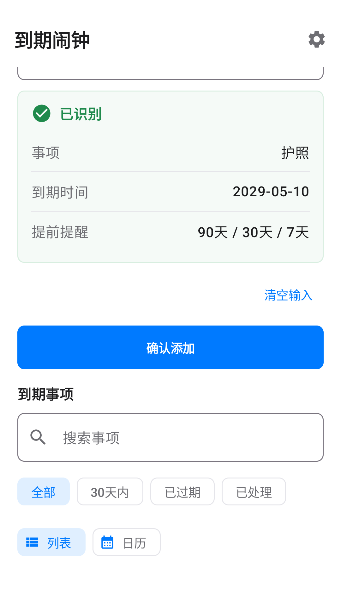
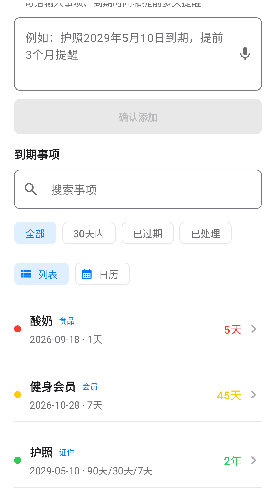
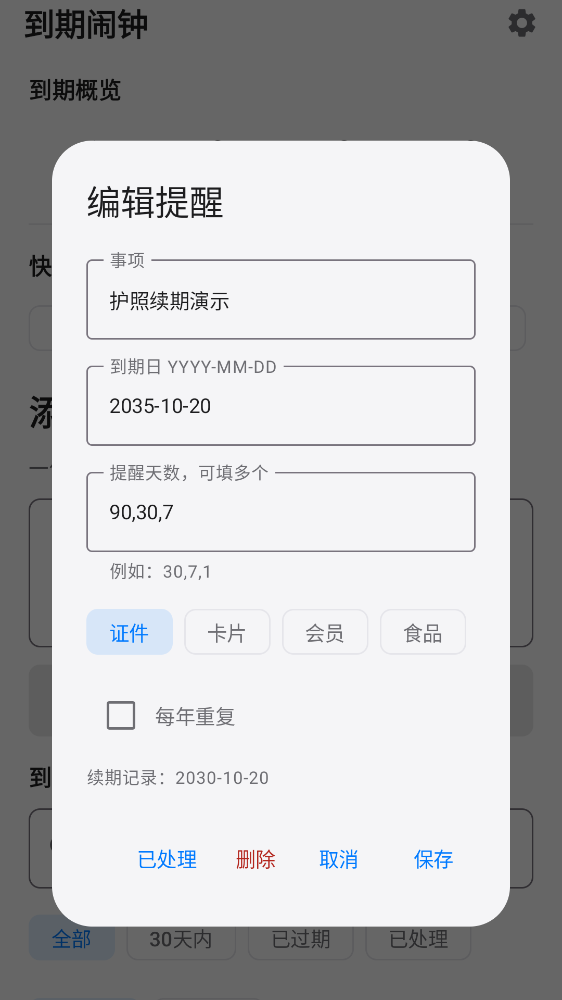

# 记物本

一款本地优先的 Android 到期事项管理应用。用户可以用一句中文记录事项、到期日期和多个提前提醒时间。

> 当前版本：`0.1.6`（`versionCode 7`）
>
> 包名：`com.daoqiji.app`
>
> Developer: Han Yongliang

## 主要功能

- 一句话解析事项、年月日和多个提醒点。
- 概览、添加、我的、设置四个导航页面，支持物品分类与快捷添加。
- 支持自定义分类、标签拖动排序及隐藏分类标签，保留已有物品数据。
- 提供在保中、30 天内过保、已过保和已处理概览。
- 展示所有未处理物品的总资产、分类金额及日均成本；支持金额识别和手动填写。
- 支持搜索、状态筛选、列表视图和按月日历视图。
- 支持每年重复、事项续期及历史到期日期。
- 支持 JSON 本地备份与恢复，无账号、广告、订阅或云同步。

## 应用截图

| 多时间提醒 | 分类列表 | 续期历史 |
| --- | --- | --- |
|  |  |  |

## 技术栈

- Kotlin + Jetpack Compose + Material 3
- Android Gradle Plugin 9.2.1 / Gradle 9.5.1
- Java 17
- `minSdk 26` / `targetSdk 35` / `compileSdk 36`

## 本地构建

准备 Android SDK 36 和 JDK 17，然后在项目根目录执行：

```bash
./gradlew assembleDebug
```

安装调试版到已连接设备：

```bash
./gradlew installDebug
```

运行本地单元测试：

```bash
./gradlew test
```

Debug 构建不需要签名文件。如需生成正式包，请参考 [`keystore/daoqiji-release.properties.example`](keystore/daoqiji-release.properties.example)，并在本地配置自己的签名证书。真实证书和密码文件已被 `.gitignore` 排除。

## 项目结构

```text
app/src/main/          应用源码和资源
app/src/test/          日期解析、提醒和备份测试
docs/                  设计与真机验证记录
release-materials/     应用商店文案、图标、截图和测试报告
```

## 数据与权限

- `POST_NOTIFICATIONS`：Android 13 及以上用于发送到期提醒。
- `RECEIVE_BOOT_COMPLETED`：设备重启后恢复已设置的提醒。

完整说明见[隐私政策](https://keke-han.github.io/expiry-alarm-privacy/)。

## 文档

- [版本记录](CHANGELOG.md)
- [第三方软件说明](THIRD_PARTY_NOTICES.md)
- [APK 测试说明](docs/APK_TESTING.md)
- [安全问题反馈](SECURITY.md)

## 版权

本项目基于 [MIT License](LICENSE) 开源，Copyright (c) 2026 Han Yongliang。第三方组件仍适用其各自许可证，详见 [THIRD_PARTY_NOTICES.md](THIRD_PARTY_NOTICES.md)。
